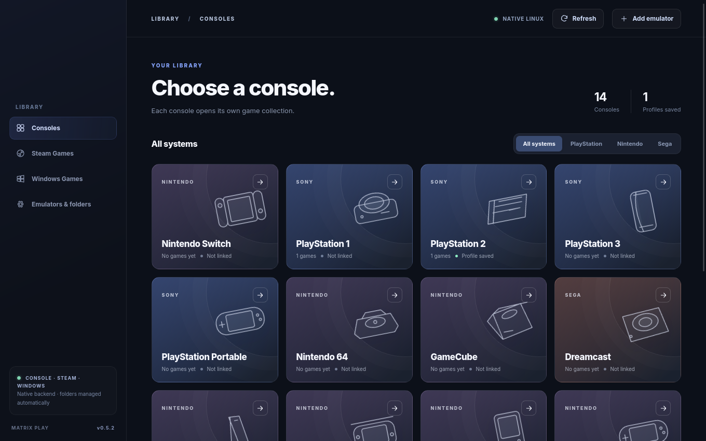

<p align="center"></p>

# Matrix Play

A native Linux game-library and emulator frontend. Browse games by console, connect each library to your installed emulator, and launch games from one application. Steam games and existing Windows-game desktop shortcuts have their own tabs.

Matrix Play organizes and launches your existing setup. Emulators, game files, firmware and keys are supplied and configured separately. Matrix Play does not provide or configure a Windows compatibility runtime.

Built with Rust and Tauri 2, Matrix Play keeps **18 console libraries**, **Steam Games**, and **Windows Games** separate. It is a library frontend, not an emulator or game store. Actual game compatibility depends on your installed emulator or the software behind your desktop shortcut.

## Fullscreen game launches and extra libraries

Click a game card to start a recognized emulator fullscreen. Matrix Play applies its engine-specific game-only options where available, including PCSX2/DuckStation no-GUI mode, RPCS3 no-GUI mode, RMG hidden menus, and Dolphin batch mode. **Open emulator** still opens configuration normally. Existing recognized profiles receive these options automatically without re-saving them. Custom/unknown launchers retain their advanced arguments; add that launcher's own fullscreen/menu-hiding options. Firmware/setup dialogs, emulator errors and emulator-specific overlays may still appear. See [EMULATOR-LAUNCHES.md](EMULATOR-LAUNCHES.md) for exact options, source references and limits.

The original 14 libraries remain separate. The supplied PS4, PS5, PS Vita and Switch 2 artwork now appears in four additional libraries, each with its own folder, local covers and favorites:

- **PS4:** experimental shadPS4 core and current QtLauncher/Flatpak support. Extracted games need `eboot.bin` with `sce_sys/param.sfo`; ELF files are also scanned. PKG installation is performed in the emulator, not by clicking a PKG in Matrix Play. Open emulator first to configure firmware and select/download a core.
- **PS Vita:** experimental current Vita3K AppImage/native support using its SDL frontend. VPK/ZIP content in the managed folder is passed to Vita3K to install and run. Complete firmware, user and license setup first; older builds without `--frontend sdl` are not supported by this preset.
- **PS5 and Switch 2:** experimental **custom emulator support**. Choose Set up emulator to link your own Linux AppImage, executable or installed Flatpak, then enter its documented launch arguments (one per line). No emulator is automatically selected and no fullscreen flags are added. PS5 scans extracted `eboot.bin`, ELF and ZAR files while preserving existing PKG/ISO collection entries; Switch 2 lists NUP/NSP/XCI files by extension without inspecting or validating their contents. Compatibility depends on your emulator/build, not the filename or artwork. See [custom launch examples](EMULATOR-LAUNCHES.md#custom-ps5-and-switch-2-emulators).

Steam and Windows retain their independent tabs and existing launch behavior. Their fullscreen settings belong to each game/launcher.

## Library folders, controllers and disc artwork

- **Manage folders** in any console library, or **Folders** in Settings, adds existing game directories on external drives without moving files. The managed folder remains available. Remove unregisters a directory only; files, saves, artwork and favorites are kept. Disconnected registrations remain listed for reconnection.
- Existing **RPCS3 installed games** can be found by adding its game directory; recognized `USRDIR/EBOOT.BIN` files retain the existing RPCS3 adapter. This is not a universal importer for emulator databases or encrypted installed content. PS3 `PARAM.SFO` and PS4 `sce_sys/param.sfo` supply display titles when valid, bounded and inside a registered folder. Missing or malformed metadata falls back to folder names. Paths, favorites and artwork IDs do not change.
- **Additional compressed images:** PSP `.chd` for current PPSSPP, GameCube `.wia`/`.ciso` and Wii `.gcz`/`.ciso` for Dolphin. Files remain compressed and launch through the existing adapters. Format recognition is not proof that a dump is valid, belongs to the selected console or works in an older emulator.
- **PS1 `.m3u` playlists** with valid local relative disc entries appear as one title for DuckStation. Missing, unsafe or unsupported playlists do not hide their discs. Existing favorited discs or discs with an imported Matrix cover remain visible alongside the playlist to preserve their customization. Dreamcast and `.m3u8` grouping are not enabled because the current standalone launchers do not share that support.
- **Standard-mapped gamepads** navigate with the D-pad/left stick, A selects, B goes back and bumpers move through controls. Directions change select options; bumpers leave the select. Modal focus, reconnect/release handling and held-button protection are included. Text entry and system file pickers still need keyboard/mouse. Actual hardware mappings and native WebKit Gamepad API availability require hardware testing.
- **Steam** detects native, Flatpak and Snap installations. **Manage Steam libraries** registers other Steam/steamapps folders with their owning client. Explicit choices win over detection and persist while drives are disconnected. Matrix Play does not configure the software Steam uses to run a game.
- **GameCube/Wii artwork** uses exact GameTDB disc IDs, with validated uncompressed disc headers or explicit filename IDs. Compressed images may require a confirmed ID in game details. Default and 3D styles keep the exact region; there is no fuzzy title matching or silent region substitution. Local covers still take priority.

## Matrix Play branding

Matrix Play adopts the supplied **Matrix Play** name and artwork. The full original PNG is used in the sidebar; a crop of its central symbol is used for the compact sidebar, window and application launcher icons.

Fresh installs create `~/Games/Matrix Play/`. If `~/Games/Matrix/` already exists, it is reused in place so game paths, cover identities and emulator profiles keep working. Configuration, artwork, the startup-cache fix, application identifier and command-line executable `matrix-frontend` remain compatible.

The Linux package is now `matrix-play`. Its package metadata replaces/conflicts with the old `matrix` package so APT can upgrade the application without colliding over its executable or launcher files. User configuration and games are retained. The GitHub repository URL remains unchanged.

## Updates and automatic releases

Use **Update** in the top bar to check public GitHub releases, read the release notes and download the newest Linux x86-64 package. Downloads persist under `$XDG_DATA_HOME/matrix/updates/`; the app checks an Ed25519 signature pinned in the application, package size and SHA-256 before installation. GitHub sign-in is not required.

Before installation, Matrix Play prompts you to save progress, close games/emulators and other apps opened through it, and wait for every installer or update to finish. Confirm this explicitly. Detected launcher/log activity and installer locks still block the update, even if the box is checked. Detached or independently launched games cannot all be detected, so the confirmation matters. Matrix never terminates games or installers for you.

A separate coordinator closes cooperating Matrix Play windows and verifies their processes and owned helpers have exited before replacing files. New Matrix startups/launches are blocked during installation. Unverified legacy or protected processes cause a clear stop, not a forced shutdown; unrelated sandboxed apps may conservatively block automatic updating. Do not terminate an unrelated process merely to bypass that check.

For a DEB installation, Linux handles authorization and a protected installer gate remains held through the package installer. For an AppImage, a coordinator copied outside the old mount installs into the writable folder and retains `.previous`; repeated installation of the same package preserves the original rollback copy. Matrix reopens automatically when possible and reports the outcome. Development builds give manual installation instructions. If automatic updating is blocked, verify Matrix is closed and use the downloaded installer manually.

These lifecycle protections start with v0.5.11. Older installed versions cannot honor them retroactively: save and close games, wait for installers to finish, close all Matrix copies and use the v0.5.11 installer manually for the first upgrade.

Maintainers: commit the changes and the next version's CHANGELOG notes, then run `python3 scripts/release.py X.Y.Z`. It updates the version, commits and pushes to main. GitHub Actions builds both packages and runs the Rust and real desktop tests. Only a successful build publishes a signed testing release; an existing published version is never overwritten. The encrypted `MATRIX_UPDATE_SIGNING_KEY` repository secret is required. See [UPDATES.md](UPDATES.md).

## v0.5.1 startup fix

A cache-dependent stall could leave v0.5.0's window blank before the first page loaded. Giving only the process a fresh cache directory reproduced a successful startup with the original data/configuration, and the affected user confirmed the workaround. The exact offending shared cache file was not identified.

Matrix Play now isolates its runtime cache under `$XDG_CACHE_HOME/matrix/runtime-v1/` (normally `~/.cache/matrix/runtime-v1/`) before creating WebKit. It does not delete shared caches, migrate game files, or replace the browser data/profile. Launched emulators, Steam, Flatpak, desktop launchers and browser/folder openers receive the original cache environment.

Startup stages and WebKit failures are logged to `$XDG_DATA_HOME/matrix/startup.log` (normally `~/.local/share/matrix/startup.log`); each launch resets that bounded diagnostic file. A visible error/retry panel handles interface script failures. This cannot replace native diagnostics when the entire web process cannot load a page.

Regression checks now include an actual painted, non-WebDriver window, normal launch from outside the project directory, Wayland without injected graphics workarounds, and restoration of launched programs' cache environments. The native driver lookup failure in the initial GitHub workflow is also corrected.

## Install the Linux test release

Download **Matrix-Play_0.5.16_amd64.deb** from the [v0.5.16 release](https://github.com/relentlesspoetry-coder/Matrix/releases/tag/v0.5.16), then run `sudo apt install ./Matrix-Play_0.5.16_amd64.deb` in its download folder. Open **Matrix Play** from the application menu. Tested on Zorin OS 18.1 / Ubuntu 24.04 base, x86-64. See [TESTING.md](TESTING.md) for setup, verified behavior and remaining limits.



## What works in the current source

- First-run directory creation for **18 systems**, under `$HOME/Games/Matrix Play/`, plus per-console folders named `* Games`.
- Independent game scanning for each console using recognized disc/ROM extensions and selected extracted layouts.
- Select an emulator executable/AppImage stored in its console directory; when unambiguous Matrix Play detects it. It can also detect several conventional emulator binaries already installed on `PATH`. Emulator setup now includes a native file browser for AppImages/executables and an installed-Flatpak chooser.
- **Single-click launching:** in a native Matrix Play build, clicking a game card immediately invokes its assigned emulator, `steam -applaunch` or a registered `.desktop` shortcut. The small information button opens details without launching.
- Steam game discovery using `appmanifest_*.acf` from standard Steam and Flatpak locations, plus Steam library folders declared in `libraryfolders.vdf`.
- Windows game registration by referencing existing `.desktop` shortcuts; no game relocation. Direct `.exe` launching is not supported. Existing direct-executable registrations and artwork are retained, but cannot launch; add a working shortcut to replace the entry.
- **Local cover art:** searches for a game-name-matched `.png`, `.jpg` or `.webp` beside the ROM (or `cover.*` in a game folder), plus Steam's local library art cache. Supports manually chosen covers saved under `$XDG_DATA_HOME/matrix/covers/` (normally `~/.local/share/matrix/covers/`), with safe per-game hash-based filenames. Artwork is loaded only for on-screen cards.
- Persistent per-console favorites with visible counts, plus console-specific search, title sorting and grid/list views. Release-year sorting is enabled only when actual year metadata is present.
- Safe process creation using discrete arguments, not shell-interpolated commands. Emulator configuration never automatically rewrites game files.

## Automatic emulator detection

On startup, **Refresh**, or **Emulators & folders → Find emulators**, Matrix Play looks for known installed Flatpak IDs, recognizable executable AppImages and conventional native emulator binaries. A single ready match is linked to its supported consoles automatically. Existing manual choices are kept. Multiple matching installations require a choice in the **Detected emulators** dropdown; missing auto-links can be replaced only by a single ready match.

AppImage scans are bounded to `~/Applications`, `~/AppImages`, `~/Downloads`, `~/.local/bin`, `~/.local/share/appimages`, the managed console folders, and AppImage paths mentioned in `~/.local/share/applications/*.desktop`. Scans are at most three levels deep in common folders, with entry limits. They never run AppImages or grant execute permission. An unexecutable AppImage is offered for explicit setup; unknown names and opaque/custom locations still need Browse. Name/header matching identifies likely emulator capabilities, not publisher authenticity. The generic Dolphin filename is intentionally excluded from global matching to avoid confusing it with KDE's file manager; `dolphin-emu` / `dolphin-emulator` AppImages are recognized.

The current catalogue includes PCSX2 → PS2; DuckStation → PS1; RPCS3 → PS3; PPSSPP → PSP; RMG → N64; Dolphin → GameCube/Wii; Flycast → Dreamcast; Cemu → Wii U; SameBoy → GB; mGBA → GB/GBA; melonDS → DS; Azahar → 3DS; Ryujinx → Switch. Detection does not install an emulator, supply firmware, configure RetroArch cores, or certify gameplay. Flatpak IDs are matched exactly to their published manifests; the supported catalogue is in `src-tauri/src/discovery.rs`.

## Open emulators and diagnose a failed launch

**Open emulator** in a console starts its linked emulator without a game, so you can finish firmware/controller setup. **Save and open emulator** is also available in the setup dialog. Saving alone does not run it.

PCSX2's installed Flatpak was reproduced crashing in fontconfig while constructing its first-run wizard, including when launched directly outside Matrix Play. A runtime-only font configuration allowed its setup and a real game boot to proceed. Matrix Play now enables **Use compatible runtime fonts** by default for the exact PCSX2 Flatpak ID; it can be turned off in setup. This supplies a small Matrix-owned font configuration file for that emulator launch only, reading runtime/app fonts and using the app's own cache. It does not delete fonts/caches or write persistent Flatpak overrides. Other Flatpak profiles may opt into the same option.

An unfinished default PCSX2 setup or empty BIOS selection now produces an explanation and an Open emulator action. This check is skipped for custom portable/data-path arguments. Complete the [PCSX2 first-run wizard](https://pcsx2.net/docs/setup/running/) using your own BIOS before booting PS2 games.

Matrix Play captures emulator output, checks early exits and displays **Launch details** instead of treating every spawned process as a successful game launch. It retains five owner-only logs per console under `$XDG_DATA_HOME/matrix/launches/`, capped at 64 KiB each, and shows the latest 8 KiB in the interface. Status tracks the launcher process; an exit with code zero may be a handoff to an existing window and is not proof of gameplay.

## Add an AppImage or Flatpak emulator

1. Open a console and choose **Set up emulator** (or **Edit emulator**).
2. Choose **AppImage file**, click **Browse…**, select your downloaded AppImage and leave **Allow this AppImage to run** checked if it needs execute permission. It can stay anywhere on your computer. If FUSE is unavailable, select **Run without FUSE**.
3. Or choose **Flatpak app** and pick an emulator from the installed-app list. Install it through Software first if missing, then click **Reload apps**. Click **Save emulator**.

Flatpak profiles remember both the app ID and its user/system/custom installation. Launching adds read access to only this console's Games folder for that run; it does not write persistent Flatpak overrides. An emulator may still require its normal firmware/configuration or different advanced launch arguments. Matrix Play does not install or run an emulator merely by saving it. Flatpak CLI behavior follows the [Flatpak command reference](https://docs.flatpak.org/en/latest/flatpak-command-reference.html); execute permission follows the [AppImage quickstart](https://docs.appimage.org/introduction/quickstart.html).

## Favorites for each console

Select a game's **heart**, then choose **My favorites** or **Favorites (count)** inside that console. Each of the 18 consoles has its own saved list. Select the heart again to remove a favorite. Empty lists explain how to add games.

Native favorites are saved with Matrix Play settings in `$XDG_CONFIG_HOME/matrix/frontend.json`, independent of the browser cache. Compatible favorites from older UI storage are imported once; removing a favorite does not cause it to return on the next launch. Unavailable games retain their saved entries and reappear as favorites when their exact paths return. Browser preview favorites still use browser storage.

## Automatic cover art

Automatic missing-art scans run after native library scans and Refresh. Providers are available for 16 of 18 libraries, with incomplete catalogs. Switch uses an exact five-character GameTDB product code plus artwork region, such as AAACA-US, or a filename containing [HAC-P-AAACA-USA]. Common 16-digit title IDs require product-code/region confirmation in details. Switch uses flat covers even with 3D selected. PS5 and Switch 2 remain local-cover only. **Emulators & folders → Cover artwork** controls automatic downloads and default/3D style. xlenore templates use PS1/PS2 serials; GameTDB templates use GameCube/Wii disc IDs. Titles are never fuzzily matched. Details show the result and identity source, and allow an explicit serial confirmation. Choose cover imports an image for any library.

Serial detection supports filenames and bounded ISO9660 SYSTEM.CNF parsing, including simple one-file, zero-origin raw BIN/CUE data tracks. Compressed images need a filename serial or user confirmation. Unsupported/ambiguous layouts stay unresolved. Local/manual covers take priority. Downloaded art, provenance, positive and negative caches persist in the XDG data directory. Provider requests are serialized, spaced, bounded, and back off on errors. The browser preview never downloads covers.

**TheCoverProject is manual only:** an explicit button opens its site, and Choose cover imports your downloaded image. Current automation authorization, API rules and copyright licensing could not be established. See [COVER-PROVIDERS.md](COVER-PROVIDERS.md) for dated evidence, exact templates, limits and policy decisions.

### Actual validation performed

Verified in source development (CI results are visible in the Actions tab):

- `cargo test --locked --manifest-path update-core/Cargo.toml`: **5 passed**, covering signed manifest identity, downgrade rejection, damaged/oversized downloads, cancellation/cache, and synthetic AppImage replacement with backup. These tests do not execute a privileged DEB upgrade.

- `cargo test --manifest-path cover-core/Cargo.toml`: **12 passed**, one live test skipped by default. These execute the actual Rust cover engine with synthetic, non-proprietary disc fixtures and an injected transport for deterministic HTTP outcomes.
- `cargo test --manifest-path cover-core/Cargo.toml live_provider_templates -- --ignored --nocapture`: **1 passed**. The real HTTPS transport retrieved and decoded default/3D covers for one PS1 and one PS2 serial; all four sample URLs worked. Temporary images were removed.
- `cargo test --manifest-path src-tauri/Cargo.toml --no-default-features --lib`: **19 passed**. This compiles and executes the same native backend functions with desktop-specific Tauri wiring excluded. The isolated-home lifecycle test verifies library separation, path validation, persisted cover settings without profile loss, loading the real online cache, local cover priority and invalid-image rejection.
- `python3 tests/test_structure.py`: all 18 console folder pairs and repeated creation preserve existing files.
- `python3 tests/test_ui.py`: Chromium integration test passed with a **mock Tauri bridge**. It covers the 18 consoles, independent Steam/Windows tabs, launch dispatch, cover controls/status, explicit serial submission, manual save, TheCoverProject button, style/disable persistence requests, responsive layout and no page script errors.
- `node --check web/app.js` and Rust formatting/parser checks passed.

**Native testing release:** full desktop `cargo check` and an optimized native build succeeded. DEB and AppImage packages were generated. The DEB was extracted and tested through its actual Tauri/WebKit window in an isolated temporary home/X11 display. `tests/test_native.py --online` passed, covering actual IPC, folders/scanning, persistent settings, local/downloaded artwork, console boundaries and launch argument dispatch to harmless test executables. Actual automatic PS1 and PS2 downloads worked in that window. The AppImage also passed the real desktop test in extraction mode, and native binary unit tests passed. The affected user confirmed real PCSX2 Flatpak game launching in installed v0.5.5 and fullscreen gameplay with no emulator menus in installed v0.5.6. Other engines are covered by source/argument tests, not universal gameplay certification; Steam and desktop-shortcut execution and other Linux platforms remain unverified; see [TESTING.md](TESTING.md).

To rerun UI tests, install Python Playwright and Chromium (`python3 -m pip install playwright`, `python3 -m playwright install chromium`). Set `MATRIX_CHROMIUM=/path/to/chrome` if using an existing Chromium binary. Run tests from the extracted folder; no proprietary ROMs are required. Standard Rust tests are offline after dependencies have been fetched; the explicit ignored smoke test requires internet access.

## Created folder structure

```text
~/Games/Matrix Play/
├── Switch/
│   └── Switch Games/
├── PS1/
│   └── PS1 Games/
├── PS2/
│   └── PS2 Games/
├── PS3/
│   └── PS3 Games/
├── PSP/
│   └── PSP Games/
├── N64/
│   └── N64 Games/
├── GameCube/
│   └── GameCube Games/
├── Dreamcast/
│   └── Dreamcast Games/
├── Wii/
│   └── Wii Games/
├── Wii U/
│   └── Wii U Games/
├── Game Boy/
│   └── Game Boy Games/
├── GBA/
│   └── GBA Games/
├── Nintendo DS/
│   └── Nintendo DS Games/
├── Nintendo 3DS/
│   └── Nintendo 3DS Games/
├── PS4/
│   └── PS4 Games/
├── PS5/
│   └── PS5 Games/
├── PS Vita/
│   └── PS Vita Games/
└── Switch 2/
    └── Switch 2 Games/
```

Each nested `* Games` folder belongs **inside** its console's parent folder. For example:

```text
~/Games/Matrix Play/PS1/
├── DuckStation.AppImage        # emulator, if using a local executable
└── PS1 Games/
    ├── My Game.cue             # disc descriptor
    ├── My Game.bin             # track data
    └── My Game.jpg             # optional locally supplied cover art
```

The native app creates these folders on first run using `bootstrap()`. Users can create them early with `./scripts/setup-folders.sh`, which only creates missing directories. It never downloads emulators, games, firmware or proprietary keys.

Steam and Windows games are **not** copied into `~/Games/Matrix Play`. They stay at their current install locations.

## Build Matrix Play on Zorin OS 18 or Ubuntu 24.04

Install Tauri's documented Linux dependencies:

```bash
sudo apt update
sudo apt install -y libwebkit2gtk-4.1-dev build-essential curl wget file \
    libxdo-dev libssl-dev libdbus-1-dev libgtk-3-dev libayatana-appindicator3-dev librsvg2-dev pkg-config
```

Install Rust 1.90 or later from <https://rustup.rs> and Node.js 20 or later. The locked Tauri dependencies require Rust 1.90. Then install the pinned Tauri CLI from this repository:

```bash
npm ci
```

Extract this archive. From the extracted source folder:

```bash
npm run tauri -- dev             # native development window
./scripts/build-native.sh        # unit tests followed by .deb and AppImage packaging
```

The build script checks Cargo, WebKitGTK 4.1 and the local npm Tauri CLI (or a Cargo-installed Tauri CLI) before building. When successful, outputs are in `src-tauri/target/release/bundle/`.

Tauri development/build commands and the build script prepare both update helpers
before compiling desktop code. If using direct desktop `cargo check`, `cargo build`
or `cargo test`, first run this from the repository root with the standard target
folder (the coordinator is a required Tauri resource):

```bash
cargo build --locked --release --manifest-path src-tauri/Cargo.toml --no-default-features --bin matrix-install-update --bin matrix-update-coordinator
```

Run backend test harnesses with `-- --test-threads=1`; their process-ownership
fixtures must not overlap other Matrix fixture launches. Unrelated protected apps
and background-process churn are explicitly tested and must not block updating.
CI uses a separate unprivileged fixture account to keep runner credentials private.


UI-only preview: open `web/index.html` in Chromium, Firefox or another browser. It uses sample games and **cannot** launch emulators or access installed game libraries. No npm install is needed.

## Limitations / next implementation work

1. Real emulator/game testing on Zorin, installed-package use on user machines, and Wayland/native-display behavior. Compilation, DEB generation and the actual Tauri window have been tested in a virtual X11 display.
2. Additional emulator-specific adapters for unusual command-line syntax, Switch installed content, installed Vita titles, Wii U metadata, Dreamcast multidisc grouping and emulator-specific Flatpak options. PS3 installed EBOOT folders and PS1 .m3u playlists are supported as described above. Emulator support differs between versions; the generic launch template is not guaranteed to work for every executable.
3. Verified PS5/Switch 2 artwork providers, automatic Switch title-ID-to-product-code mapping, nonstandard Sony serial formats and compressed-disc identity extraction remain future work. Manual cover imports work for every library; TheCoverProject automation is not enabled.
4. Windows games are organized through existing `.desktop` shortcuts only. These must already work outside Matrix Play; any software they invoke is managed externally. Matrix Play does not install, configure or invoke a Windows compatibility runtime directly. Steam games continue to launch through the owning Steam installation, whose own compatibility choices are outside Matrix Play.
5. Physical-controller testing, nonstandard controller mappings and controller-only text entry/system dialogs remain future work. Standard-mapped navigation and launch/exit diagnostics are implemented; emulator input configuration remains external.
6. Broader emulator-specific and distribution testing. The existing native harness uses non-proprietary fixtures and harmless test launchers; it does not validate actual gameplay.

Matrix Play is not an emulator. Do not distribute copyrighted ROMs, BIOS, encryption keys or proprietary system firmware with it.

## Native desktop test and GitHub builds

The [Linux workflow](.github/workflows/linux.yml) builds DEB/AppImage artifacts on Ubuntu 24.04 for pushes to main, pull requests and manual runs. It runs Rust, folder and native-window checks. The first published installers were also built locally on Zorin 18.1. GitHub workflow status is independent of the local checks.

To run the real desktop test after building, install `webkit2gtk-driver xvfb xauth`, install `tauri-driver` with `cargo install tauri-driver --version 2.1.0 --locked`, then run:

```bash
xvfb-run -a python3 tests/test_native.py src-tauri/target/release/matrix-frontend
# Add --online to exercise real PS1/PS2 cover downloads.
```

This test creates an isolated temporary library and harmless launcher fixtures; it does not test actual gameplay or use your installed libraries. The browser test's `matrix-native-*` screenshots show a simulated native bridge; `matrix-linux-home.png` shows the compiled desktop window.

The cloud runner has no physical GPU: its Xvfb checks explicitly use software graphics and allow up to 15 seconds for the window to paint. Those CI settings are confined to the test steps. The application does not force those graphics flags on user machines. Ordinary local X11/Wayland startup checks are reported separately from cloud software-rendering checks. Failed paint checks retain a screenshot artifact for diagnosis.

The native window/asset-loading check passed with an existing legacy library, the ordinary painted-window check passed with the new default library root, and the v0.5.2 branding migration's APT simulation selected only replacement of `matrix` by `matrix-play`. These are migration/build checks; actual installation still requires the user's APT command. The supplied full logo's bytes were verified unchanged. The published v0.5.3 workflow and signed download checks subsequently passed. On the affected Zorin installation, replacing the still-installed v0.5.0 package with v0.5.3 resolved normal menu startup; the user confirmed it opens normally. See TESTING.md for the dated verification and remaining limits.
